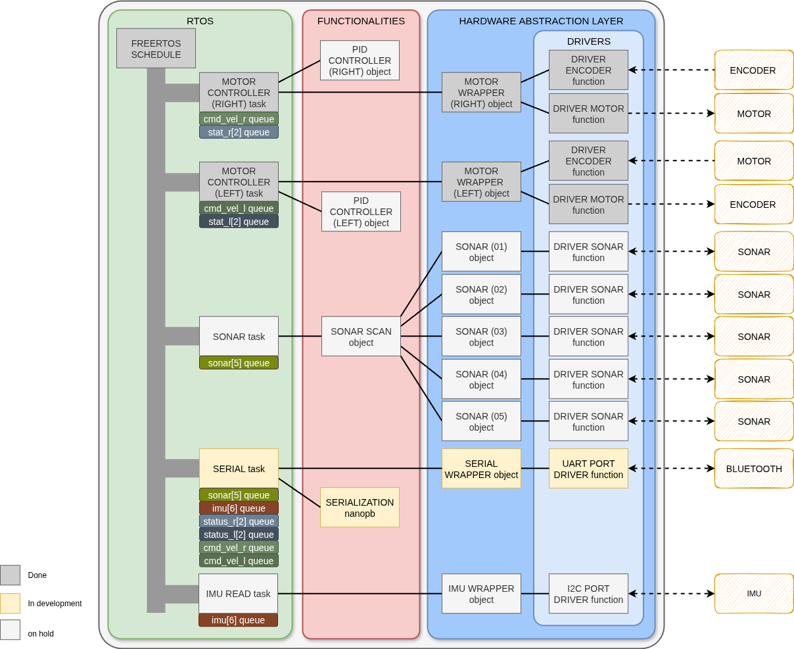
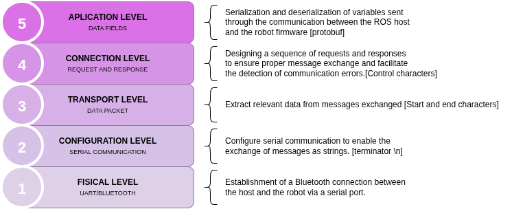
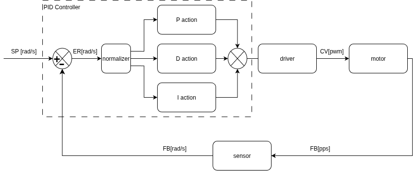

# Littlebot Firmware

Embedded firmware for the **Littlebot mobile robot**, targeting the Texas Instruments TM4C123GH6PM microcontroller.

The firmware provides the low-level control and communication functionality required by the robot. It is developed in C and uses FreeRTOS for real-time task management, TivaWare for microcontroller peripheral access, and nanopb for Protocol Buffers serialization.

## Features

- **Target platform:** TI TM4C123GH6PM (ARM Cortex-M4F)
- **Programming language:** C11
- **Real-time operating system:** FreeRTOS
- **Hardware abstraction and peripheral access:** TivaWare
- **Communication serialization:** Protocol Buffers using nanopb
- **Build system:** GNU Arm Embedded Toolchain and GNU Make
- **Documentation:** Doxygen and Sphinx

## Firmware architecture

The firmware is organized into application-level modules and hardware-specific drivers. Its current implementation includes motor and encoder drivers, serial communication, PID control, and FreeRTOS application tasks.

The following diagrams provide an overview of the current design.

### Hardware and firmware architecture



### Communication protocol



### Wheel controller




## Development environment

The firmware build requires:

- GNU Make
- GNU Arm Embedded Toolchain (`arm-none-eabi-gcc`)
- TI TivaWare 2.2.0.295
- FreeRTOS kernel (provided as a Git submodule)
- nanopb (provided as a Git submodule)

The TivaWare installation is external to this repository. The Makefile expects the `TIVAWARE_DIR` environment variable to point to the TivaWare installation directory.

### Clone the repository

Clone the repository and initialize its submodules:

```bash
git clone --recurse-submodules https://github.com/NestorDP/littlebot_firmware.git
cd littlebot_firmware
```

If the repository was cloned without submodules, initialize them with:

```bash
git submodule update --init --recursive
```

### Configure TivaWare

Set `TIVAWARE_DIR` to the directory containing the TivaWare installation:

```bash
export TIVAWARE_DIR=/path/to/TivaWare
```

Make sure the installation provides the `driverlib/` and `utils/` directories expected by the Makefile.

### Build the firmware

Build the firmware image using GNU Make:

```bash
make
```

The Makefile provides additional targets:

```bash
make rebuild
make debug
make debug_rebuild
make size
make clean
```

Use `make help` to display the available targets.

## Contributing

Contributions should follow the firmware architecture and coding conventions documented in the engineering documentation.

When modifying public interfaces or firmware modules, update the corresponding Doxygen comments and verify that the generated documentation remains consistent with the implementation.

## Related repositories

The firmware is part of the Littlebot multi-repository project:

- [Littlebot](https://github.com/NestorDP/littlebot) — ROS 2 software
- [Littlebot Gazebo](https://github.com/NestorDP/littlebot_gazebo) — robot simulation
- [Littlebot RQT Plugin](https://github.com/NestorDP/littlebot_rqt_plugin) — graphical interface
- [Littlebot Hardware](https://github.com/NestorDP/littlebot_hardware) — hardware design
- [Littlebot Workspace](https://github.com/NestorDP/littlebot_workspace) — system integration and engineering documentation

## License

This project is distributed under the MIT License. See [LICENSE](LICENSE) for details.


